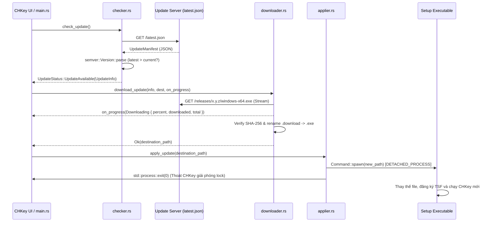

# Hướng dẫn Kỹ thuật dành cho AI (AI Developer Guide) - `chkey_updater`

Tài liệu này cung cấp toàn bộ ngữ cảnh kỹ thuật, kiến trúc luồng dữ liệu, đặc tả API và các quy chuẩn cốt lõi của **CHKey Updater** (`chkey_updater`). Bất kỳ trợ lý AI nào đọc tài liệu này đều có thể nhanh chóng nắm bắt và thực hiện review, sửa lỗi hoặc mở rộng cơ chế cập nhật tự động một cách chính xác nhất.

---

## 1. Tổng quan Dự án (Project Overview)
- **Bản chất crate:** `chkey_updater` là một crate hỗn hợp gồm:
  - **Library (`chkey_updater`):** Cung cấp API bất đồng bộ (async Tokio) kiểm tra phiên bản mới, stream tải file cập nhật, kiểm tra mã băm SHA-256 và kích hoạt bộ cài đặt mới.
  - **Binary trung gian (`chkey_installer`):** Trình hoán đổi file nhị phân độc lập (dùng khi cập nhật file `.exe` trực tiếp).
- **Mục tiêu:** Cung cấp cơ chế cập nhật không gián đoạn (Over-the-Air Update) cho CHKey trên Windows và macOS, bảo đảm an toàn dữ liệu và chống file lock của hệ điều hành.

---

## 2. Kiến trúc Thư mục (Architecture)

```text
CHKey/updater/
├── Cargo.toml          # Khai báo crate (reqwest, serde, tokio, semver, sha2, futures-util)
├── AI_GUIDE.md         # Hướng dẫn kỹ thuật chuyên sâu dành cho AI Developer
├── README.md           # Hướng dẫn sử dụng tính năng cập nhật cho Người dùng cuối
└── src/
    ├── lib.rs          # Khai báo các module, re-export API chính và HTTP Client tĩnh
    ├── model.rs        # Các struct/enum dữ liệu (UpdateManifest, UpdateInfo, DownloadProgress...)
    ├── platform.rs     # Tự động nhận diện nền tảng (windows-x64, windows-arm64, macos...)
    ├── checker.rs      # Truy vấn manifest từ server và so sánh phiên bản semver
    ├── downloader.rs   # Tải file theo luồng (chunk streaming), tính % và kiểm tra SHA-256
    ├── applier.rs      # Khởi chạy bộ cài đặt và thoát ứng dụng hiện tại an toàn
    └── installer.rs    # [Tùy chọn] Binary độc lập chkey_installer đợi PID thoát rồi ghi đè file
```

---

## 3. Điểm bắt đầu & Luồng Dữ liệu (Data Flow)

Toàn bộ quy trình cập nhật chia làm 3 bước bất đồng bộ nối tiếp nhau:



### 3.1. Cấu trúc Manifest trên Server (`latest.json`)
```json
{
  "app_id": "chkey",
  "channel": "stable",
  "platforms": {
    "windows-x64": {
      "version": "1.2.0",
      "url": "/releases/1.2.0/windows-x64.exe",
      "sha256": "a77bbd7585772515870554859bdf0607760e403ec0811156f6046a81ebaf668a"
    },
    "windows-arm64": {
      "version": "1.2.0",
      "url": "/releases/1.2.0/windows-arm64.exe",
      "sha256": "..."
    }
  }
}
```

---

## 4. Các Quy Chuẩn Bắt Buộc Khi Code & Review (Strict Guidelines)

1. **An toàn Tải File (Atomic Stream Download):**
   - Không tải trực tiếp vào file đích. Luôn tải vào file tạm có đuôi `.download`.
   - Tính toán băm SHA-256 song song với quá trình đọc stream (on-the-fly digest).
   - Chỉ khi mã băm SHA-256 trùng khớp 100% với server manifest mới đổi tên sang file đích thực tế (`rename`). Nếu tải lỗi hoặc SHA-256 không khớp, lập tức xóa file tạm `.download`.
2. **Giải quyết Vấn đề File Lock trên Windows:**
   - Trên Windows, một tiến trình đang chạy (`CHKey.exe`) không thể bị xóa hay ghi đè trực tiếp bởi tiến trình khác.
   - Do đó, `apply_update` bắt buộc phải tạo tiến trình cài đặt mới với cờ `DETACHED_PROCESS` (tách rời hoàn toàn khỏi tiến trình cha) và gọi ngay `std::process::exit(0)`.
3. **Cơ chế Khởi chạy Đa hình (Hybrid Applier):**
   - Nếu có sẵn công cụ thay thế file `chkey_installer.exe`, gọi kèm tham số `--pid`, `--target`, `--new`.
   - Nếu không có (mô hình bộ cài độc lập như `windows-x64.exe` / `CHKey_Setup.exe`), khởi chạy trực tiếp file `.exe` vừa tải về vì bản thân nó đã chứa logic giải nén, ghi đè và khởi động lại.
4. **So sánh Phiên bản bằng SemVer Chuẩn:**
   - Tuyệt đối không so sánh chuỗi (string comparison) như `"1.10.0" < "1.2.0"`.
   - Luôn sử dụng crate `semver::Version` để phân tích ngữ nghĩa phiên bản chính xác.
5. **Zero-Panic trong Network & I/O:**
   - Mọi lỗi kết nối mạng (HTTP timeout, mất mạng), lỗi phân tích JSON, lỗi ghi file hoặc sai mã băm đều phải trả về `Result<_, String>`, không được dùng `unwrap()` gây crash ứng dụng gõ phím.

---

## 5. Bảng Đặc tả Kiểu Dữ liệu & Public API (Public API Reference)

### 5.1. Structs & Enums chính (`model.rs`)
```rust
pub struct UpdateInfo {
    pub current_version: String,
    pub latest_version: String,
    pub platform: String,
    pub download_url: String,
    pub sha256: String,
}

pub enum UpdateStatus {
    UpToDate,
    UpdateAvailable(UpdateInfo),
}

pub enum DownloadProgress {
    Downloading {
        downloaded: u64,
        total: Option<u64>,
        percent: Option<f32>,
    },
    Completed {
        path: std::path::PathBuf,
    },
}
```

### 5.2. Các Hàm Cốt lõi
```rust
// 1. Kiểm tra phiên bản mới từ server
pub async fn check_update() -> Result<UpdateStatus, String>;

// 2. Tải bản cập nhật với callback cập nhật tiến trình
pub async fn download_update<F>(
    info: &UpdateInfo,
    destination: impl AsRef<Path>,
    on_progress: F,
) -> Result<PathBuf, String>
where
    F: FnMut(DownloadProgress) + Send;

// 3. Kích hoạt cài đặt và thoát ứng dụng an toàn
pub fn apply_update(new_file_path: impl AsRef<Path>) -> Result<(), String>;
```

---

## 6. Hướng dẫn Thiết lập Máy chủ Cập nhật (How to Deploy Update Server)

Khi phát hành phiên bản mới của CHKey (ví dụ bản `v1.2.0`):

1. **Biên dịch bộ cài đặt:**
   ```bash
   cargo build -p chkey_setup --release
   ```
2. **Đổi tên file theo nền tảng** (ví dụ: `target/release/CHKey_Setup.exe` thành `windows-x64.exe`).
3. **Tính mã SHA-256 của file:**
   - **PowerShell (Windows):**
     ```powershell
     Get-FileHash .\windows-x64.exe -Algorithm SHA256 | Select-Object -ExpandProperty Hash
     ```
   - **Linux / macOS:**
     ```bash
     sha256sum windows-x64.exe
     ```
4. **Cập nhật file `latest.json`** trên máy chủ web:
   - Điền đúng `version`, `url` và mã `sha256` (chữ thường).
   - Đảm bảo server hỗ trợ HTTP range và trả về header `Content-Length`.
